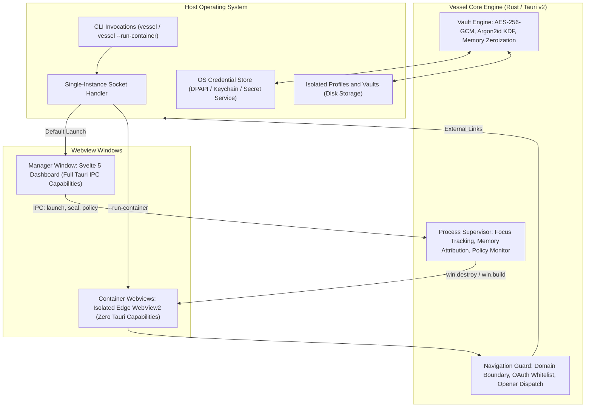

# Vessel

[](https://github.com/basilahmad/vessel/actions/workflows/ci.yml)
[](https://v2.tauri.app/)
[-orange.svg)](https://svelte.dev/)
[](https://www.rust-lang.org/)
[](LICENSE)

Vessel is a high-performance, lightweight desktop web application container engine built with **Tauri v2 (Rust)** and **SvelteKit (Svelte 5 with runes)**. It isolates and manages web applications (such as GitHub, Spotify, Slack, Linear, and Notion) in dedicated, memory-efficient native windows featuring **authenticated AES-256-GCM encrypted profile vaults**, **process tree idle hibernation**, **scope-restricted navigation guards**, and **native desktop shortcuts**.

---

## Architecture

Vessel is engineered around a **Decoupled Manager-Container Architecture**:



### 1. Manager Mode (`vessel`)
* Executing `vessel` without arguments launches the management dashboard.
* Built with SvelteKit 2, Svelte 5 runes (`$state`, `$derived`, `$effect`), and Tailwind CSS.
* Provides a launcher-first control center with dual view densities (`minimal` default and `detailed`), real-time resource tracking, estimated Electron baseline comparisons, encrypted vault controls, and container policy configuration.

### 2. Container Mode (`vessel --run-container <ID>`)
* Executing `vessel --run-container <ID>` boots **only** the target webview window bound to its isolated data directory.
* **The Manager DOM is never loaded or rendered in container mode**, keeping memory overhead minimal and startup instantaneous.
* Secondary launches are automatically forwarded to the primary running instance through Tauri's single-instance plugin without process duplication.

---

## Core Features

### 1. Strict Profile Isolation
Cookies, HTTP cache, localStorage, IndexedDB, and service workers are strictly segregated on disk per container profile:
* **Windows**: `%LOCALAPPDATA%\Vessel\profiles\<CONTAINER_ID>`
* **macOS**: `~/Library/Application Support/Vessel/profiles/<CONTAINER_ID>`
* **Linux**: `~/.local/share/Vessel/profiles/<CONTAINER_ID>`

### 2. Process Supervisor & Idle Hibernation
* **Process Tree Attribution**: Monitors active WebView2 child processes by matching `--user-data-dir` command-line arguments to aggregate working set RAM and CPU usage across browser, GPU, renderer, and utility processes. If command-line access is restricted, the supervisor falls back to window PID inspection and tags the metric with an `[estimated]` badge in the UI.
* **Working Set Reclamation**: When an unfocused container exceeds its inactivity threshold (default 15 minutes, configurable globally and per container), its OS webview process is destroyed via `win.destroy()`, releasing its working set memory back to the operating system.
* **Instant Wake**: Refocusing or clicking **Wake** in the dashboard recreates the webview window pointing to its last persisted route.
* **Lingering Process Detection**: Reports residual process memory during hibernation rather than assuming 0 MB.

### 3. Encrypted Profile Vaults (`VSSLVAULT2`)
Profile data can be sealed and encrypted at rest with industry-standard cryptography:
* **Dual Encryption Modes**:
  * **Mode 0 (OS Keyring)**: Automatic 256-bit random key generated and securely stored in the native OS credential store (Windows Credential Manager / DPAPI, macOS Keychain, Linux Secret Service).
  * **Mode 1 (Master Passphrase)**: Key derived using **Argon2id** with a 128-bit cryptographically secure salt.
* **Authenticated Cipher**: **AES-256-GCM** with 96-bit random nonces and 128-bit GHASH authentication tags.
* **Atomic Sealing & Decryption Verification**: Before wiping plaintext profile directories, Vessel writes the encrypted archive to a temporary file, executes `fsync`, atomically renames the file, and runs a test decryption in memory to verify that the SHA-256 hash matches the unencrypted archive. If verification fails, plaintext profiles are preserved.
* **Cryptographic Memory Zeroization**: Key buffers and sensitive archive payloads are wrapped in `Zeroizing<[u8; 32]>` to wipe plaintext secrets from RAM immediately upon completion.
* **Automatic Seal on Close**: Automatically locks and seals profile directories into encrypted `.vault` archives when container windows are closed.

### 4. Scope-Restricted Navigation Guard & SSO Whitelist
* **Domain Boundary Enforcement**: Container navigation is constrained to the target hostname, its subdomains, and the root domain (e.g. `linear.app` and `app.linear.app`).
* **OAuth / SSO Provider Pass-Through**: Built-in whitelist allows seamless authentication redirects through major identity providers, including Google, Microsoft, Apple, GitHub, GitLab, Okta, Clerk, Slack, Discord, Atlassian, and Twitter/X.
* **External Link Offloading**: Any out-of-scope link is automatically intercepted and opened in the host system's default browser via `tauri-plugin-opener`, preventing untrusted navigation drift.

### 5. Reactive Dual-Density Dashboard
* **Minimal Mode (Default)**: Clean, keyboard-navigable launcher showing container statuses, active tags, and primary action buttons.
* **Detailed Mode**: Expands cards to display live CPU sparklines, working-set RAM metrics, idle countdown meters, and comparative baseline indicators.
* **Interactive Toasts with Undo**: Non-destructive operations (such as manual hibernation and vault locking) present quick Undo actions to immediately restore the active container.
* **Action State Management**: Action buttons feature integrated progress spinners for `isWaking`, `isLaunching`, and `isUnlocking` to prevent duplicate submissions.

### 6. Native Desktop Integration
Generates standalone desktop shortcuts linking directly to `vessel --run-container <ID>` with the application's cached high-resolution icon:
* **Windows**: Native `.lnk` shortcuts generated via `WScript.Shell` with `.ico` icons.
* **macOS**: Executable `.command` scripts with Cocoa-applied custom icon metadata.
* **Linux**: Freedesktop-compliant `.desktop` application launchers.

---

## Limitations & Design Decisions

* **Hibernation State Loss**: Hibernation terminates the container's underlying webview process (`win.destroy()`) to return 100% of working-set RAM to the OS. As a consequence, in-page JavaScript state is reset (e.g. audio streams, active video calls, unsaved draft forms, and transient WebSockets). To safeguard streaming and communication tools, enable the **"Never hibernate"** toggle in the container's settings.
* **Audio Playback Detection**: WebView2's `ICoreWebView2_8::IsDocumentPlayingAudio` was evaluated. Direct invocation requires unmanaged COM vtable dispatch without official Tauri/wry wrapper support. To avoid brittle unmanaged memory assumptions and maintain system stability across Windows runtime updates without heavy external dependencies, automated audio sniffing was intentionally omitted in favor of the explicit **"Never hibernate"** policy.
* **Protection at Rest Only**: Encrypted vaults defend against offline filesystem theft, unencrypted file backups, and cold disk image extraction. When a container is active, its profile is temporarily unpacked so the native webview engine can read cookies and storage.
* **Windows-First Architecture**: While cross-platform code paths exist for basic window creation and keyrings, features like WebView2 process tree inspection, COM-based shortcut generation, and working set telemetry are tailored for modern Windows 10/11 environments.

---

## Tech Stack

| Layer | Technologies |
|---|---|
| **Frontend** | SvelteKit 2, Svelte 5 (Runes: `$state`, `$derived`, `$effect`), TypeScript, Tailwind CSS, Vite |
| **Backend** | Rust (2021 edition), Tauri v2, `sysinfo`, `aes-gcm`, `argon2`, `keyring`, `zeroize`, `tokio` |
| **Testing** | Vitest (frontend unit & rune tests), Cargo Test (cryptographic verification, supervisor policy tests) |
| **Tooling** | Python 3 + `psutil` + `matplotlib` + `scipy` (empirical benchmarking suite) |

---

## Repository Structure

```text
Vessel/
├── .github/
│   └── workflows/ci.yml           # Windows CI: typecheck, vitest, cargo test, clippy, fmt
├── benchmarks/
│   ├── electron-shell/            # Standalone Electron comparison harness
│   ├── synthetic_example/         # Watermarked synthetic prototype charts & data
│   ├── analyze_and_plot.py        # Statistical visualization script
│   └── run_benchmarks.py          # Empirical multi-run test runner (psutil telemetry)
├── src/                           # SvelteKit 5 Frontend
│   ├── lib/
│   │   ├── components/            # ContainerCard, TopBar, MemoryHero, VaultUnlockModal, etc.
│   │   ├── stores/                # appSettings, toastStore, etc.
│   │   └── data/                  # electron_baseline.json (assumed / measured baseline)
│   └── routes/                    # Root dashboard page & layouts
├── src-tauri/                     # Rust Backend (Tauri v2)
│   ├── capabilities/              # Scoped permissions (zero capabilities for container webviews)
│   └── src/
│       ├── main.rs                # Single-instance handler, CLI parsing, navigation filter
│       ├── commands.rs            # Tauri IPC command dispatch
│       ├── profile.rs             # Profile storage, settings persistence, ICO extraction
│       ├── supervisor.rs          # Process tree attribution & idle hibernation engine
│       └── vault.rs               # VSSLVAULT2 format, AES-256-GCM, Argon2id, Keyring provider
├── CHANGELOG.md                   # Chronological development history
├── README.md                      # Project documentation
└── SECURITY.md                    # Detailed threat model & security boundaries
```

---

## Getting Started

### Prerequisites

* [Node.js](https://nodejs.org/) 18+ and npm
* [Rust](https://rustup.rs/) 1.77+ with Cargo
* Modern Windows 10/11 with the Microsoft Edge WebView2 runtime (preinstalled on modern Windows)

### Installation

Clone the repository and install frontend dependencies:

```bash
git clone https://github.com/basilahmad/vessel.git
cd vessel
npm install
```

### Development

Run the frontend dev server and Tauri Rust application concurrently:

```bash
npm run tauri dev
```

To boot directly into a specific container in development mode:

```bash
npm run tauri dev -- -- --run-container <CONTAINER_ID>
```

---

## Testing & Quality Assurance

Run the complete test and linting pipeline locally before submitting changes:

```bash
# 1. Frontend TypeScript & Svelte type checking
npm run check

# 2. Frontend Vitest unit test suite
npm run test

# 3. Backend Rust unit and integration tests
cd src-tauri && cargo test

# 4. Backend code formatting check
cargo fmt --check

# 5. Backend Clippy linter with zero warnings
cargo clippy -- -D warnings
```

---

## Performance Benchmarking

Vessel includes an empirical benchmarking suite in `benchmarks/` to measure cold start latency, resident set memory (RSS MB), and CPU usage against Electron and Google Chrome.

### Setup Benchmark Environment

```bash
pip install -r benchmarks/requirements.txt
cd benchmarks/electron-shell && npm install && cd ../..
```

### Run Live Empirical Tests

```bash
# Build production release binary
cd src-tauri && cargo build --release && cd ..

# Execute 10 live runs with 95% confidence intervals
python benchmarks/run_benchmarks.py --runs 10
```

Results are saved to `benchmarks/results/measured_benchmark_data.csv`.

To generate figures from empirical data:

```bash
python benchmarks/analyze_and_plot.py --input benchmarks/results/measured_benchmark_data.csv
```

> **Note on Baseline Data**: `src/lib/data/electron_baseline.json` ships with `"source": "assumed"`. Once you run the live benchmark harness on your local hardware, update `electron_baseline.json` with your measured results and set `"source": "measured"`. Vessel strictly enforces honest performance claims.

---

## CLI Reference

| Command | Description |
|---|---|
| `vessel` | Launches the Manager GUI dashboard. |
| `vessel --run-container <ID>` | Launches or focuses the target container webview directly. |
| `vessel --run-container="<ID>"` | Alternative syntax for desktop shortcuts and scripts. |

---

## Security & Disclosure

Please review our [SECURITY.md](SECURITY.md) for the full threat model, cryptographic architecture details, and vulnerability disclosure guidelines.

---

## License

This project is licensed under the [MIT License](LICENSE).
